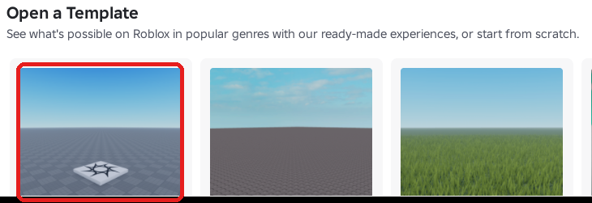
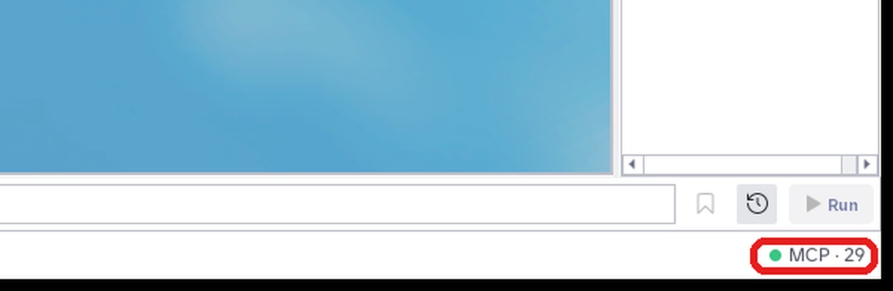
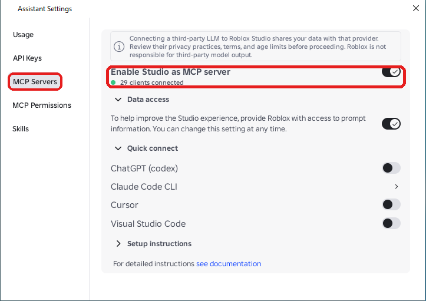
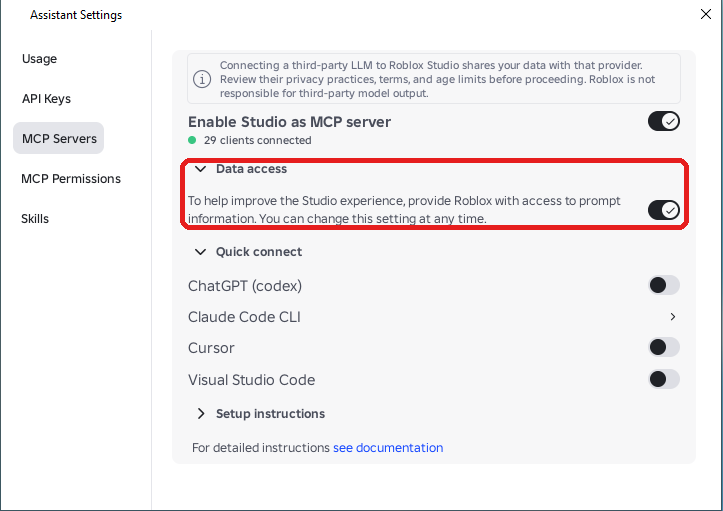

# StoryKit Free: Cài Roblox Studio và kết nối với Claude Code

Hướng dẫn không chính thức cho người làm nội dung trên Roblox Studio. **Không liên kết với Roblox Corporation.**

Sổ tay này giúp bạn cài Roblox Studio và kết nối nó với Claude Code, để Claude có thể làm việc trực tiếp trong Studio của bạn. Mỗi bước có câu lệnh mẫu để bạn dán vào Claude Code.

## Bạn cần gì
- Máy Windows 10/11: **đã thử trên Windows 10/11; macOS chưa thử.** Bước 3 dùng lệnh riêng của Windows; trên Mac sẽ khác.
- Một tài khoản Roblox (miễn phí).
- Claude Code đã cài và đăng nhập.

## Cài plugin StoryKit Free
Trong Claude Code gõ:
`/plugin marketplace add thegentleminh/thegentleminh-skills` rồi `/plugin install storykit-free@thegentleminh`.

## Bước 1: Cài Roblox Studio
Dán vào Claude Code:
> Kiểm tra giúp mình máy đã có Roblox Studio chưa. Nếu chưa thì hướng dẫn mình cài.

Nếu chưa có: **Tải Roblox Studio** từ trang chính thức của Roblox: **https://create.roblox.com/docs/studio/setup** → bấm **Download Studio** → trong hộp thoại bấm **Download Studio** lần nữa → mở file vừa tải (`RobloxStudio.exe` trên Windows) → khi cài xong bấm **Launch Studio** → đăng nhập bằng tài khoản Roblox (chưa có thì tạo ở roblox.com). Chỉ tải Studio từ trang của Roblox; StoryKit không gửi file cài đặt nào.

## Bước 2: Mở một place trống
Mở Studio, ở trang đầu kéo xuống mục **Open a Template** và chọn **Baseplate** (hình). Đừng dùng game thật đang chạy của bạn.

## Bước 3: Kết nối Claude Code với Roblox Studio *(Windows)*
Dán vào Claude Code:
> Kết nối Claude Code với Roblox Studio MCP giúp mình.

Claude sẽ đưa lệnh `claude mcp add ... Roblox_Studio ...`. Rồi trong Studio: bấm chữ **MCP** ở góc dưới bên phải cửa sổ (hình 1) → **Assistant Settings** → **MCP Servers** → bật **Enable Studio as MCP server** (hình 2). Xong thì **khởi động lại Claude Code**.

Cùng trang đó có mục **Data access**: khi bật, Roblox được xem thông tin prompt của bạn để cải thiện Studio. Tắt đi nếu bạn không muốn chia sẻ (hình 3).

## Bước 4: Kiểm tra kết nối
Dán vào Claude Code:
> kiểm tra kết nối

Kết quả đúng: "Đã kết nối Roblox Studio (<tên place>)."

## Nếu gặp lỗi
Dán vào Claude Code:
> Bước <số> bị lỗi: [bạn thấy gì]. Giải thích lỗi bằng lời dễ hiểu, sửa và thử lại đúng bước đó. Không đụng vào game hay file của mình ngoài thư mục này.

Lỗi hay gặp:
- **Claude không thấy Roblox Studio:** chạy lại lệnh ở bước 3, rồi khởi động lại Claude Code.
- **Thấy nhưng không có place nào:** mở một place trong Studio và bật MCP server.
- **Đổi place thì mất kết nối:** bình thường; gõ lại "kiểm tra kết nối".

Báo lỗi cho bọn mình ở **GitHub Issues**: https://github.com/thegentleminh/thegentleminh-skills/issues.

## Xong rồi
**Giờ bạn đã cài xong Roblox Studio và MCP. Bạn có thể tự hỏi Claude để tìm hiểu cách dùng.**

## Muốn nhanh hơn? StoryKit Pass
Nếu bạn muốn cách nhanh hơn, đỡ tốn hơn để làm video Short kể chuyện kiểu "Ở thế giới này…" ngay trong Studio, có **StoryKit Pass**: quy trình từ ý tưởng, kịch bản, dựng cảnh, nhân vật diễn, quay đến dựng phim, cùng kho ý tưởng, kịch bản mẫu và công thức được cập nhật thường xuyên. Pass vẫn chạy trên tài khoản Claude của bạn. Xem trên trang StoryKit.

StoryKit không hứa lượt xem hay thu nhập.
