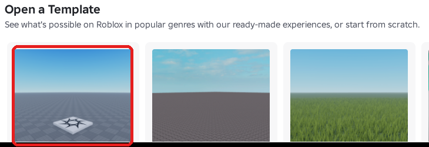
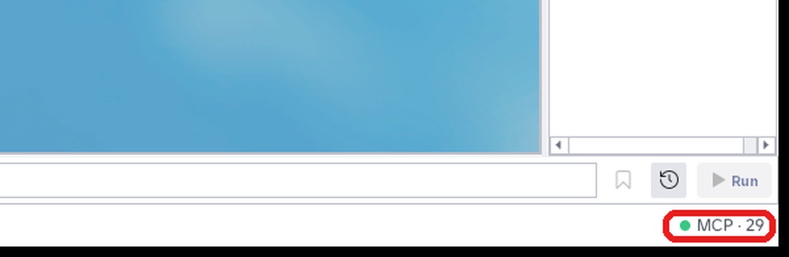
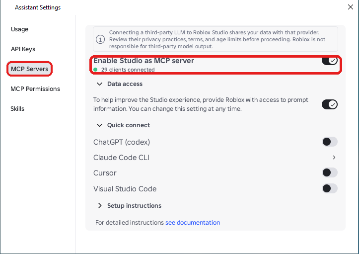
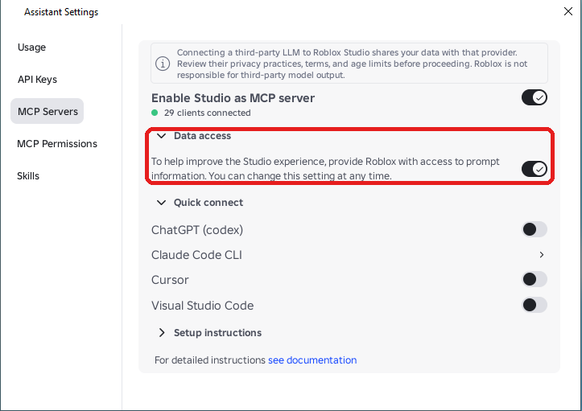

# Blocky StoryKit: Sổ tay sử dụng

Blocky StoryKit giúp bạn làm video Short kể chuyện kiểu "Ở thế giới này…" (dọc 9:16, 2-2,5 phút), quay ngay trong Roblox Studio của bạn: từ ý tưởng, kịch bản, dựng cảnh, nhân vật diễn, quay, đến phụ đề, nhạc và xuất video.

Công cụ không chính thức dành cho người làm nội dung trên Roblox Studio. **Không liên kết với Roblox Corporation.** Blocky StoryKit không bán asset nào: mọi mô hình, quần áo, bầu trời, hoạt ảnh đều là đồ miễn phí hoặc đồ trong catalogue, được tải bằng ID ngay trong Studio của bạn.

## 1. Bạn cần gì

- Máy Windows 10/11: **đã thử trên Windows 10/11; macOS chưa thử.** Các bước có ghi *(Windows)* là lệnh riêng của Windows; trên Mac sẽ khác.
- **Roblox Studio** (miễn phí) và một tài khoản Roblox.
- **Claude Code** (Blocky StoryKit chạy trên tài khoản Claude của bạn).
- **ffmpeg** và **Python 3.10+** (hướng dẫn cài ở bước 2).
- **Mã Pass Blocky StoryKit** (trong trang tài khoản trên website).
- Giọng đọc: giọng của bạn, hoặc giọng AI miễn phí (TTSMaker, VoiceStudio; xem mục 4b).
- Không bắt buộc: card NVIDIA (canh chữ theo giọng đọc nhanh hơn).

## 2. Cài đặt trong 5 bước

1. **Tải Roblox Studio** từ trang chính thức của Roblox: **https://create.roblox.com/docs/studio/setup** → bấm **Download Studio** → trong hộp thoại bấm **Download Studio** lần nữa → mở file vừa tải (`RobloxStudio.exe` trên Windows) → khi cài xong bấm **Launch Studio** → đăng nhập bằng tài khoản Roblox (chưa có thì tạo ở roblox.com). Chỉ tải Studio từ trang của Roblox; Blocky StoryKit không gửi file cài đặt nào.
   Rồi mở một place trống: ở trang đầu của Studio, mục **Open a Template**, chọn **Baseplate**. (Khi làm video, Blocky StoryKit tự tạo place riêng cho từng video.)

   
2. **Cài Python và ffmpeg** *(Windows)*: mở **Terminal** (bấm Start, gõ "Terminal") và chạy lần lượt:
   ```
   winget install -e --id Python.Python.3.12
   winget install -e --id Gyan.FFmpeg
   ```
   **Đóng Terminal, mở lại**, rồi chạy:
   ```
   python -m pip install numpy opencv-python faster-whisper
   ```
   (winget là trình cài ứng dụng có sẵn trong Windows 10/11; Python từ python.org, ffmpeg bản của gyan.dev. Nếu gõ `python` mà Windows mở Microsoft Store: vào Settings → Apps → App execution aliases, tắt hai mục "python", rồi mở lại Terminal.)
   Kiểm tra: dán vào Claude Code
   > Kiểm tra giúp mình máy đã có Python 3.10 trở lên, ffmpeg, và các gói numpy, opencv-python, faster-whisper chưa. Thiếu gì thì chỉ mình cách cài, hỏi mình trước khi cài.

   Kết quả đúng: Claude báo đủ cả ba (Python, ffmpeg, các gói). Sau khi cài Blocky StoryKit (bước 4), bước kiểm tra kết nối cũng kiểm tra lại những thứ này. Phông chữ phụ đề Claude sẽ hỏi tải sau, khi làm video đầu tiên.
3. **Kết nối Claude Code với Roblox Studio** *(lệnh Windows)*: trong Terminal chạy
   `claude mcp add --transport stdio Roblox_Studio -- cmd.exe /c "cd /d %LOCALAPPDATA%\Roblox && .\mcp.bat"`
   rồi trong Studio bật MCP server: bấm chữ **MCP** ở góc dưới bên phải cửa sổ Studio (hình 1) → mở **Assistant Settings** → mục **MCP Servers** → bật **Enable Studio as MCP server** (hình 2).

   

   

   **Nên tắt Data access trước khi dùng** (cùng trang đó, hình 3; mục này mặc định đang bật). Khi bật, Studio tự thêm hook vào cài đặt Claude Code của bạn (file `%USERPROFILE%\.claude\settings.json`). Các hook này chuyển **mọi câu lệnh bạn gõ trong Claude Code, ở mọi dự án, không chỉ việc Roblox**, cho Roblox. Tắt xong, dán vào Claude Code:
   > Kiểm tra file cài đặt Claude Code của mình có hook nào gọi StudioMCPHook.bat không. Nếu có, sao lưu file rồi xóa các hook đó; hỏi mình trước khi xóa.

   
4. **Cài Blocky StoryKit**: trong Claude Code gõ
   ```
   /plugin marketplace add thegentleminh/thegentleminh-skills
   ```
   rồi
   ```
   /plugin install storykit@thegentleminh
   ```
   Claude Code sẽ hỏi **mã Pass** (trong email): dán mã vào. Nếu nó chưa hỏi, gõ `/plugin configure storykit@thegentleminh` rồi dán mã. Mã được lưu trong kho bảo mật của máy, không nằm trong file nào của Blocky StoryKit.
5. **Khởi động lại Claude Code** rồi gõ **`kiểm tra kết nối`**.

## 3. Kiểm tra kết nối

Gõ `kiểm tra kết nối` bất cứ lúc nào. Claude trả lời một dòng cho Roblox Studio và một dòng cho Blocky StoryKit Pass, ví dụ:

> Đã kết nối Roblox Studio (Baseplate) · Đã kết nối Blocky StoryKit Pass · Pass còn hạn đến 31/12/2026 · Máy này đang giữ chỗ (1/1).

Nếu có dòng báo lỗi, làm theo hướng dẫn ngay trong câu trả lời:
- **Chưa kết nối Roblox Studio**: mở Studio, mở một place, bật MCP, gõ lại.
- **Chưa kết nối Blocky StoryKit Pass**: gõ `/plugin`, chọn storykit, nhập lại mã Pass, rồi gõ `/mcp` để kết nối lại.
- **Pass hết hạn**: gia hạn ở trang tài khoản.
- **Mã Pass đang dùng trên máy khác**: mỗi mã Pass dùng trên 1 máy. Đổi máy thì vào trang Pass của tôi (https://thegentleminh.com/pass/cua-toi/), gỡ máy cũ (mỗi tuần một lần), rồi gõ lại `kiểm tra kết nối`.
- **Máy chủ không phản hồi**: không phải lỗi của bạn; thử lại sau ít phút. Trong lúc đó Claude vẫn làm được phần cơ bản.

## 4. Video đầu tiên

Mở một thư mục trống cho video (ví dụ `Videos/ngu-nhieu-giau`), mở Claude Code trong thư mục đó và dán:

> Làm cho mình một video Short "Ở thế giới này, ai ngủ càng nhiều càng giàu". Người kể là một bé trai, ba bị mất ngủ nên nhà nghèo nhất phố. Giọng miền Nam, mình tự thu giọng.

Lần đầu Claude sẽ hỏi vài câu cài đặt (giọng đọc, độ dài, kiểu ánh sáng, kiểu phụ đề...). Mỗi câu đều có lựa chọn **"Mình chưa chắc, giải thích giúp"** và **"Cho xem tất cả để so sánh"**. Trả lời một lần, lần sau không hỏi lại.

Rồi Claude làm theo thứ tự: tiền đề và tiêu đề → kịch bản (**bạn duyệt trước khi thu giọng**) → shot plan → dựng cảnh và nhân vật (có ảnh cho bạn xem) → quay từng take trong Studio → ghép, phụ đề, nhạc → video cuối và bảng kiểm tra.

Khi Studio đang quay: **để cửa sổ Studio ở trên cùng, màn hình sáng, không dùng máy**.

Lần đầu, Claude sẽ tải phương pháp Blocky StoryKit về thư mục video (mục 5). Thêm câu lệnh mẫu: xem `skills/studio-story-shorts/examples/prompts.md`.

## 4b. Giọng đọc

Sau khi bạn duyệt kịch bản, Claude làm **bảng thu giọng** (`narration/sheet.md`): mỗi câu một dòng, có số thứ tự và tên file. Bạn làm mỗi câu một file, đặt tên bắt đầu bằng số (ví dụ `012_BA.wav`), bỏ hết vào thư mục `narration/in/`. Claude kiểm tra từng câu (đọc sai chữ, rè, nhỏ quá, ồn, im lặng lâu), báo câu nào cần làm lại, rồi ghép thành một file giọng hoàn chỉnh.

Bạn chọn một trong bốn cách:
1. **Tự thu giọng**: điện thoại cũng được, phòng yên tĩnh, không mở nhạc.
2. **ElevenLabs** (trả phí, giọng tự nhiên nhất): dùng tài khoản ElevenLabs của bạn, tạo từng câu rồi tải về. Hướng dẫn: **thegentleminh.com/ky-nang/elevenlabs/**
3. **TTSMaker** (trên trình duyệt, không cần cài): miễn phí **20.000 ký tự mỗi tuần** (vài giọng không giới hạn). Trang TTSMaker ghi được dùng cho mục đích thương mại miễn phí; nên xem lại điều khoản trước khi đăng.
4. **VoiceStudio** (ứng dụng miễn phí trên máy): mô hình mặc định (OmniVoice) **chỉ dùng phi thương mại (CC-BY-NC)**, nên không dùng cho kênh bật kiếm tiền, trừ khi bạn chọn mô hình có giấy phép cho phép.

Hướng dẫn cài và dùng TTSMaker, VoiceStudio: **thegentleminh.com/ky-nang/voicestudio/**

Giọng từ ứng dụng khác cũng dùng được: xuất mỗi câu một file theo số trong bảng.

Mẹo: mỗi lần tạo chỉ dán **một câu**; xuất WAV hoặc MP3; mỗi nhân vật giữ một giọng cho cả kênh; làm lại câu nào thì lưu file mới (`012_BA take2.wav`), đừng ghi đè. TTSMaker và VoiceStudio nghe "máy" hơn giọng thật; giọng AI nói chung đọc chậm hơn (khoảng 200 từ/phút): Blocky StoryKit có thể tăng tốc cả bài lên 1,2-1,3 lần mà không đổi cao độ.

## 5. Blocky StoryKit Pass làm gì

Plugin Blocky StoryKit bạn cài chỉ là phần khởi động: kiểm tra kết nối và tải phương pháp. **Toàn bộ phương pháp** (quy trình 7 bước, cách viết kịch bản, shot plan, thư viện Studio cho máy quay, diễn xuất, khuôn mặt, nhân vật, ánh sáng, công cụ ghép take, giọng, phụ đề, âm thanh) đến từ máy chủ Blocky StoryKit Pass, cùng với phần cập nhật liên tục: công thức hook và tiêu đề, kho tiền đề và twist, kịch bản mẫu, công thức mới nhất, danh mục asset đã kiểm tra.

- Lần đầu làm video, Claude tải phương pháp về thư mục `.storykit` trong thư mục video (khoảng 110 KB) và báo "Đã tải phương pháp Blocky StoryKit bản …". Khi có bản mới, Claude tự tải lại.
- Nếu máy chủ tạm không phản hồi, Claude dùng bản đã lưu, miễn là Pass còn hạn.
- **Hết Pass:** Blocky StoryKit dừng làm video mới. Video và mọi file bạn đã làm vẫn là của bạn.
- Đừng sửa hay chia sẻ các file trong `.storykit`: chúng chỉ dùng trong máy bạn và sẽ được thay khi tải bản mới.
- Để biết mã Pass đang dùng trên máy nào, plugin gửi kèm một mã máy đã được băm (hash) từ mã máy của hệ điều hành. Nó không phải tên máy, tên người dùng hay số phần cứng, và không dùng để biết bạn là ai.

## 6. Giới hạn

- Mỗi mã Pass dùng trên 1 máy; đổi máy thì gỡ máy cũ trong Pass của tôi, mỗi tuần một lần.
- Studio phải ở cửa sổ trên cùng và màn hình phải sáng khi quay; nếu không, video bị giật hoặc đen.
- Mỗi take quay tối đa khoảng 25-30 giây; một video 2 phút cần 5-8 take, Blocky StoryKit tự ghép.
- Nhân vật là R15 khối với đầu động (dynamic head): miệng mở theo lời, mặt đổi cảm xúc, nhưng không khớp môi từng âm và ngón tay không cử động.
- Asset miễn phí trên Studio còn ít đồ Việt Nam (chùa, nhà ống, xe bánh mì...). Khi thiếu, Blocky StoryKit tìm theo thứ tự: danh mục riêng của nó → tìm trên Creator Store → **chỉ khi cả hai không có mới tạo bằng generate_mesh** (công cụ miễn phí của Roblox; mặc định khuyên dùng, bạn chọn ở bước cài đặt). Lưu ý: **mỗi lần tạo, kể cả tạo lại, sẽ lưu vĩnh viễn một Package riêng trong kho Roblox của bạn và tính vào giới hạn sử dụng tạo mô hình của Roblox.** Chữ trên bảng hiệu do máy tạo bị méo, nên bảng hiệu được thêm chữ riêng sau đó.
- Một video 2 phút mất khoảng 2-4 giờ Claude làm việc.
- Avatar và đồ catalogue trong video của bạn thuộc trách nhiệm của bạn theo điều khoản Roblox. Nhân vật không mặc áo/quần từ catalogue sẽ bị Roblox gắn bộ đồ mặc định có logo Roblox: Blocky StoryKit luôn mặc đồ cho nhân vật và báo trước khi quay nếu có ai còn thiếu. Không xuất asset ra ngoài Studio, không dùng logo Roblox.
- Blocky StoryKit không hứa lượt xem hay thu nhập; nó giúp bạn tiết kiệm thời gian và kể chuyện tốt hơn.
- Blocky StoryKit được làm bằng Claude Code nên có thể còn lỗi; Claude của bạn sửa được (mục 7).

## 7. Nếu gặp lỗi

Dán câu này vào Claude Code:

> Blocky StoryKit vừa bị lỗi: [mô tả bạn thấy gì, ở bước nào]. Hãy giải thích nguyên nhân bằng lời dễ hiểu, đọc lại skill và công cụ liên quan, sửa rồi chạy lại đúng phần bị lỗi. Không đụng vào file gốc của mình ngoài thư mục video này.

Claude sẽ giải thích lỗi, sửa và chạy lại. Nếu đó là lỗi của Blocky StoryKit, hãy báo cho bọn mình ở **GitHub Issues**: https://github.com/thegentleminh/thegentleminh-skills/issues để mọi người cùng được sửa.

Lỗi hay gặp: video giật (Studio không ở trên cùng), take đen (màn hình tắt), có khung hình màu hồng (quay lại take đó), nhân vật lún xuống đất (Claude chạy lại bước đặt chân), nhạc lấn giọng (Claude giảm nhạc, không tăng giọng).

**Mỗi lần gõ đều báo "UserPromptSubmit hook error" hoặc "Stop hook error" kèm StudioMCPHook.bat:** đó là hook của Data access. Tắt Data access trong Studio (hình 3), rồi nhờ Claude xóa các hook gọi StudioMCPHook.bat trong `%USERPROFILE%\.claude\settings.json` (sao lưu file trước).

## 8. Câu hỏi thường gặp

**Blocky StoryKit có tốn Robux không?** Không bắt buộc. Mọi thứ nó dùng là đồ miễn phí hoặc đồ catalogue mặc thử trong Studio. Một số món quần áo trong catalogue giá vài Robux nếu bạn muốn mua cho avatar của mình, nhưng để quay trong Studio thì không cần mua.

**Có cần card RTX không?** Không. Card NVIDIA chỉ giúp bước canh chữ theo giọng chạy nhanh hơn; không có thì chạy bằng CPU, chậm hơn một chút. Roblox Studio chạy tốt trên máy chơi game phổ thông.

**Hết Pass thì video đã làm có còn không?** Còn. Video và mọi file bạn đã làm là của bạn. Hết Pass thì Blocky StoryKit dừng làm video mới; gia hạn là dùng tiếp.

**Dùng một Pass trên hai máy được không?** Không. Mỗi mã Pass dùng trên 1 máy. Đổi máy (máy mới, hay cài lại Windows) thì vào trang Pass của tôi gỡ máy cũ, mỗi tuần một lần. Máy nào 30 ngày không dùng Blocky StoryKit thì tự nhường chỗ.

**Có dùng được cho kênh tiếng Anh không?** Bản này viết cho tiếng Việt (giọng, phụ đề, cách nói). Tiếng Anh: chưa hỗ trợ.

**Video có bị coi là nội dung lặp lại không?** Blocky StoryKit có bước chống lặp mẫu: mỗi video mới khác hai video trước về dạng chuyện, câu mở và kiểu kết. Bạn vẫn là người chọn ý tưởng và duyệt kịch bản.
